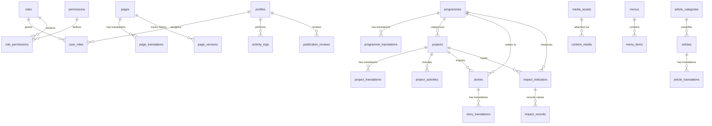

# DATABASE SCHEMA: BABAWATOTO ORGANIZATION WEBSITE & CMS

## 1. Overview & Design Principles
- **Database Engine**: Supabase PostgreSQL 17
- **Normalization**: 3NF relational schema with dedicated translation tables (`*_translations`) for bilingual English (`en`) and Kiswahili (`sw`) support.
- **Controlled JSONB**: Used strictly for structured page-builder blocks (`page_translations.blocks`), SEO metadata objects, and audit log diffs—validated server-side via Zod before persistence.
- **Unified Workflow Enum**: Every publishable entity uses a standardized `publication_status` enum:
  `('draft', 'pending_review', 'approved', 'scheduled', 'published', 'archived')`
- **Language Enum**: `language_code` enum: `('en', 'sw')`
- **Auditability**: Every content table tracks `created_at`, `updated_at`, `created_by`, and `updated_by` referencing `public.profiles(id)`.

---

## 2. Entity-Relationship Diagram

---

## 3. Complete Table Definitions (31 Core Tables)

### 3.1 Identity, Roles & Permissions

#### 1. `profiles`
Links 1:1 with `auth.users(id)`.
- `id` (`UUID`, PK, FK -> `auth.users.id ON DELETE CASCADE`)
- `email` (`TEXT`, UNIQUE, NOT NULL)
- `full_name` (`TEXT`, NOT NULL)
- `job_title` (`TEXT`)
- `avatar_media_id` (`UUID`, FK -> `media_assets.id ON DELETE SET NULL`)
- `is_active` (`BOOLEAN`, NOT NULL DEFAULT `true`)
- `last_login_at` (`TIMESTAMPTZ`)
- `created_at` (`TIMESTAMPTZ`, NOT NULL DEFAULT `now()`)
- `updated_at` (`TIMESTAMPTZ`, NOT NULL DEFAULT `now()`)

#### 2. `roles`
- `id` (`UUID`, PK DEFAULT `gen_random_uuid()`)
- `slug` (`TEXT`, UNIQUE, NOT NULL) — `'super_admin'`, `'website_admin'`, `'editor'`, `'contributor'`, `'media_manager'`, `'viewer'`
- `name` (`TEXT`, NOT NULL)
- `description` (`TEXT`, NOT NULL)
- `is_system_role` (`BOOLEAN`, NOT NULL DEFAULT `true`)
- `created_at` (`TIMESTAMPTZ`, NOT NULL DEFAULT `now()`)

#### 3. `permissions`
- `id` (`UUID`, PK DEFAULT `gen_random_uuid()`)
- `code` (`TEXT`, UNIQUE, NOT NULL) — e.g., `'pages.create'`, `'pages.publish'`, `'media.delete'`, `'users.manage'`
- `module` (`TEXT`, NOT NULL)
- `description` (`TEXT`, NOT NULL)

#### 4. `user_roles`
- `user_id` (`UUID`, FK -> `profiles.id ON DELETE CASCADE`)
- `role_id` (`UUID`, FK -> `roles.id ON DELETE CASCADE`)
- `assigned_by` (`UUID`, FK -> `profiles.id ON DELETE SET NULL`)
- `assigned_at` (`TIMESTAMPTZ`, NOT NULL DEFAULT `now()`)
- **Primary Key**: `(user_id, role_id)`

#### 5. `role_permissions`
- `role_id` (`UUID`, FK -> `roles.id ON DELETE CASCADE`)
- `permission_id` (`UUID`, FK -> `permissions.id ON DELETE CASCADE`)
- **Primary Key**: `(role_id, permission_id)`

---

### 3.2 Media & Storage Management

#### 6. `media_assets`
Metadata for files stored in `/home/babawatotoor/bao-cms-storage/`.
- `id` (`UUID`, PK DEFAULT `gen_random_uuid()`)
- `original_filename` (`TEXT`, NOT NULL)
- `generated_filename` (`TEXT`, UNIQUE, NOT NULL)
- `file_extension` (`TEXT`, NOT NULL)
- `mime_type` (`TEXT`, NOT NULL)
- `file_size_bytes` (`BIGINT`, NOT NULL)
- `storage_provider` (`TEXT`, NOT NULL DEFAULT `'cpanel_local'`)
- `storage_key` (`TEXT`, UNIQUE, NOT NULL) — relative path inside storage root
- `media_type` (`TEXT`, NOT NULL) — `'image'`, `'document'`, `'video'`
- `category` (`TEXT`, NOT NULL) — `'organization'`, `'programmes'`, `'projects'`, `'staff'`, `'stories'`, `'events'`, `'reports'`, `'publications'`, `'policies'`, `'resources'`
- `visibility` (`TEXT`, NOT NULL DEFAULT `'public'`) — `'public'` or `'private'`
- `width` (`INTEGER`, NULL)
- `height` (`INTEGER`, NULL)
- `title_en` (`TEXT`)
- `title_sw` (`TEXT`)
- `alt_text_en` (`TEXT`)
- `alt_text_sw` (`TEXT`)
- `caption_en` (`TEXT`)
- `caption_sw` (`TEXT`)
- `safeguarding_cleared` (`BOOLEAN`, NOT NULL DEFAULT `false`)
- `uploaded_by` (`UUID`, FK -> `profiles.id ON DELETE SET NULL`)
- `created_at` (`TIMESTAMPTZ`, NOT NULL DEFAULT `now()`)
- `updated_at` (`TIMESTAMPTZ`, NOT NULL DEFAULT `now()`)

#### 7. `content_media`
Polymorphic join table tracking media usage across Pages, Programmes, Projects, Articles, and Stories.
- `id` (`UUID`, PK DEFAULT `gen_random_uuid()`)
- `media_id` (`UUID`, NOT NULL, FK -> `media_assets.id ON DELETE RESTRICT`)
- `entity_type` (`TEXT`, NOT NULL) — `'page'`, `'programme'`, `'project'`, `'article'`, `'story'`, `'event'`
- `entity_id` (`UUID`, NOT NULL)
- `usage_role` (`TEXT`, NOT NULL DEFAULT `'gallery'`) — `'featured'`, `'gallery'`, `'attachment'`, `'verification'`
- `display_order` (`INTEGER`, NOT NULL DEFAULT `0`)
- `created_at` (`TIMESTAMPTZ`, NOT NULL DEFAULT `now()`)
- **Index**: `(entity_type, entity_id, usage_role)`

---

### 3.3 Dynamic Pages & Controlled Page Builder

#### 8. `pages`
- `id` (`UUID`, PK DEFAULT `gen_random_uuid()`)
- `page_key` (`TEXT`, UNIQUE, NOT NULL) — e.g., `'home'`, `'about-who-we-are'`, `'contact'`
- `template` (`TEXT`, NOT NULL DEFAULT `'standard'`) — `'home'`, `'standard'`, `'programme'`, `'contact'`, `'policy'`
- `parent_page_id` (`UUID`, NULL, FK -> `pages.id ON DELETE SET NULL`)
- `status` (`publication_status`, NOT NULL DEFAULT `'draft'`)
- `featured_media_id` (`UUID`, NULL, FK -> `media_assets.id ON DELETE SET NULL`)
- `published_at` (`TIMESTAMPTZ`)
- `scheduled_for` (`TIMESTAMPTZ`)
- `created_by` (`UUID`, FK -> `profiles.id ON DELETE SET NULL`)
- `updated_by` (`UUID`, FK -> `profiles.id ON DELETE SET NULL`)
- `created_at` (`TIMESTAMPTZ`, NOT NULL DEFAULT `now()`)
- `updated_at` (`TIMESTAMPTZ`, NOT NULL DEFAULT `now()`)

#### 9. `page_translations`
- `id` (`UUID`, PK DEFAULT `gen_random_uuid()`)
- `page_id` (`UUID`, NOT NULL, FK -> `pages.id ON DELETE CASCADE`)
- `language` (`language_code`, NOT NULL)
- `title` (`TEXT`, NOT NULL)
- `slug` (`TEXT`, NOT NULL)
- `subtitle` (`TEXT`)
- `excerpt` (`TEXT`)
- `blocks` (`JSONB`, NOT NULL DEFAULT `'[]'::jsonb`) — Validated array of the 16 controlled block types
- `seo_title` (`TEXT`)
- `seo_description` (`TEXT`)
- `og_image_media_id` (`UUID`, FK -> `media_assets.id ON DELETE SET NULL`)
- `translation_status` (`publication_status`, NOT NULL DEFAULT `'draft'`)
- `updated_by` (`UUID`, FK -> `profiles.id ON DELETE SET NULL`)
- `created_at` (`TIMESTAMPTZ`, NOT NULL DEFAULT `now()`)
- `updated_at` (`TIMESTAMPTZ`, NOT NULL DEFAULT `now()`)
- **Unique Constraints**: `(page_id, language)`, `(language, slug)`

#### 10. `page_versions`
Immutable version snapshots created on every save/publish for rollback and audit.
- `id` (`UUID`, PK DEFAULT `gen_random_uuid()`)
- `page_id` (`UUID`, NOT NULL, FK -> `pages.id ON DELETE CASCADE`)
- `language` (`language_code`, NOT NULL)
- `version_number` (`INTEGER`, NOT NULL)
- `title` (`TEXT`, NOT NULL)
- `blocks_snapshot` (`JSONB`, NOT NULL)
- `status_at_snapshot` (`publication_status`, NOT NULL)
- `change_note` (`TEXT`)
- `created_by` (`UUID`, FK -> `profiles.id ON DELETE SET NULL`)
- `created_at` (`TIMESTAMPTZ`, NOT NULL DEFAULT `now()`)

---

### 3.4 Programmes Management

#### 11. `programmes`
- `id` (`UUID`, PK DEFAULT `gen_random_uuid()`)
- `code` (`TEXT`, UNIQUE, NOT NULL) — e.g., `'child-protection'`, `'education'`, `'heart-creative-arts'`
- `featured_media_id` (`UUID`, FK -> `media_assets.id ON DELETE SET NULL`)
- `display_order` (`INTEGER`, NOT NULL DEFAULT `0`)
- `status` (`publication_status`, NOT NULL DEFAULT `'draft'`)
- `published_at` (`TIMESTAMPTZ`)
- `created_by` (`UUID`, FK -> `profiles.id ON DELETE SET NULL`)
- `updated_by` (`UUID`, FK -> `profiles.id ON DELETE SET NULL`)
- `created_at` (`TIMESTAMPTZ`, NOT NULL DEFAULT `now()`)
- `updated_at` (`TIMESTAMPTZ`, NOT NULL DEFAULT `now()`)

#### 12. `programme_translations`
- `id` (`UUID`, PK DEFAULT `gen_random_uuid()`)
- `programme_id` (`UUID`, NOT NULL, FK -> `programmes.id ON DELETE CASCADE`)
- `language` (`language_code`, NOT NULL)
- `title` (`TEXT`, NOT NULL)
- `slug` (`TEXT`, NOT NULL)
- `short_description` (`TEXT`, NOT NULL)
- `full_description` (`TEXT`, NOT NULL) — Sanitized rich text
- `objectives` (`JSONB`, NOT NULL DEFAULT `'[]'::jsonb`) — Array of structured objective strings
- `activities` (`JSONB`, NOT NULL DEFAULT `'[]'::jsonb`) — Array of programme activities
- `target_beneficiaries` (`TEXT`)
- `geographic_coverage` (`TEXT`)
- `seo_title` (`TEXT`)
- `seo_description` (`TEXT`)
- `translation_status` (`publication_status`, NOT NULL DEFAULT `'draft'`)
- `updated_by` (`UUID`, FK -> `profiles.id ON DELETE SET NULL`)
- `created_at` (`TIMESTAMPTZ`, NOT NULL DEFAULT `now()`)
- `updated_at` (`TIMESTAMPTZ`, NOT NULL DEFAULT `now()`)
- **Unique Constraints**: `(programme_id, language)`, `(language, slug)`

---

### 3.5 Projects Management

#### 13. `projects`
- `id` (`UUID`, PK DEFAULT `gen_random_uuid()`)
- `project_code` (`TEXT`, UNIQUE)
- `programme_id` (`UUID`, FK -> `programmes.id ON DELETE SET NULL`)
- `project_status` (`TEXT`, NOT NULL DEFAULT `'ongoing'`) — `'planned'`, `'ongoing'`, `'completed'`
- `start_date` (`DATE`)
- `end_date` (`DATE`)
- `implementing_partners` (`TEXT[]`, NOT NULL DEFAULT `'{}'`)
- `donors` (`TEXT[]`, NOT NULL DEFAULT `'{}'`)
- `featured_media_id` (`UUID`, FK -> `media_assets.id ON DELETE SET NULL`)
- `is_featured` (`BOOLEAN`, NOT NULL DEFAULT `false`)
- `status` (`publication_status`, NOT NULL DEFAULT `'draft'`)
- `published_at` (`TIMESTAMPTZ`)
- `scheduled_for` (`TIMESTAMPTZ`)
- `created_by` (`UUID`, FK -> `profiles.id ON DELETE SET NULL`)
- `updated_by` (`UUID`, FK -> `profiles.id ON DELETE SET NULL`)
- `created_at` (`TIMESTAMPTZ`, NOT NULL DEFAULT `now()`)
- `updated_at` (`TIMESTAMPTZ`, NOT NULL DEFAULT `now()`)

#### 14. `project_translations`
- `id` (`UUID`, PK DEFAULT `gen_random_uuid()`)
- `project_id` (`UUID`, NOT NULL, FK -> `projects.id ON DELETE CASCADE`)
- `language` (`language_code`, NOT NULL)
- `title` (`TEXT`, NOT NULL)
- `slug` (`TEXT`, NOT NULL)
- `short_description` (`TEXT`, NOT NULL)
- `full_description` (`TEXT`, NOT NULL)
- `objectives` (`JSONB`, NOT NULL DEFAULT `'[]'::jsonb`)
- `location` (`TEXT`)
- `public_beneficiary_summary` (`TEXT`) — Non-confidential public summary only
- `seo_title` (`TEXT`)
- `seo_description` (`TEXT`)
- `translation_status` (`publication_status`, NOT NULL DEFAULT `'draft'`)
- `updated_by` (`UUID`, FK -> `profiles.id ON DELETE SET NULL`)
- `created_at` (`TIMESTAMPTZ`, NOT NULL DEFAULT `now()`)
- `updated_at` (`TIMESTAMPTZ`, NOT NULL DEFAULT `now()`)
- **Unique Constraints**: `(project_id, language)`, `(language, slug)`

#### 15. `project_activities`
- `id` (`UUID`, PK DEFAULT `gen_random_uuid()`)
- `project_id` (`UUID`, NOT NULL, FK -> `projects.id ON DELETE CASCADE`)
- `title_en` (`TEXT`, NOT NULL)
- `title_sw` (`TEXT`)
- `description_en` (`TEXT`)
- `description_sw` (`TEXT`)
- `activity_date` (`DATE`)
- `location` (`TEXT`)
- `display_order` (`INTEGER`, NOT NULL DEFAULT `0`)
- `created_at` (`TIMESTAMPTZ`, NOT NULL DEFAULT `now()`)

---

### 3.6 News, Events & Stories of Change

#### 16. `article_categories`
- `id` (`UUID`, PK DEFAULT `gen_random_uuid()`)
- `slug` (`TEXT`, UNIQUE, NOT NULL)
- `name_en` (`TEXT`, NOT NULL)
- `name_sw` (`TEXT`, NOT NULL)
- `display_order` (`INTEGER`, NOT NULL DEFAULT `0`)

#### 17. `articles` (Unified News Articles & Events)
- `id` (`UUID`, PK DEFAULT `gen_random_uuid()`)
- `content_type` (`TEXT`, NOT NULL DEFAULT `'news'`) — `'news'` or `'event'`
- `category_id` (`UUID`, FK -> `article_categories.id ON DELETE SET NULL`)
- `featured_media_id` (`UUID`, FK -> `media_assets.id ON DELETE SET NULL`)
- `tags` (`TEXT[]`, NOT NULL DEFAULT `'{}'`)
- `event_start_at` (`TIMESTAMPTZ`, NULL)
- `event_end_at` (`TIMESTAMPTZ`, NULL)
- `event_location` (`TEXT`, NULL)
- `event_registration_url` (`TEXT`, NULL)
- `event_status` (`TEXT`, NULL) — `'upcoming'`, `'ongoing'`, `'past'`, `'cancelled'`
- `status` (`publication_status`, NOT NULL DEFAULT `'draft'`)
- `published_at` (`TIMESTAMPTZ`)
- `scheduled_for` (`TIMESTAMPTZ`)
- `created_by` (`UUID`, FK -> `profiles.id ON DELETE SET NULL`)
- `updated_by` (`UUID`, FK -> `profiles.id ON DELETE SET NULL`)
- `created_at` (`TIMESTAMPTZ`, NOT NULL DEFAULT `now()`)
- `updated_at` (`TIMESTAMPTZ`, NOT NULL DEFAULT `now()`)

#### 18. `article_translations`
- `id` (`UUID`, PK DEFAULT `gen_random_uuid()`)
- `article_id` (`UUID`, NOT NULL, FK -> `articles.id ON DELETE CASCADE`)
- `language` (`language_code`, NOT NULL)
- `title` (`TEXT`, NOT NULL)
- `slug` (`TEXT`, NOT NULL)
- `excerpt` (`TEXT`, NOT NULL)
- `body` (`TEXT`, NOT NULL)
- `event_registration_info` (`TEXT`, NULL)
- `seo_title` (`TEXT`)
- `seo_description` (`TEXT`)
- `translation_status` (`publication_status`, NOT NULL DEFAULT `'draft'`)
- `updated_by` (`UUID`, FK -> `profiles.id ON DELETE SET NULL`)
- `created_at` (`TIMESTAMPTZ`, NOT NULL DEFAULT `now()`)
- `updated_at` (`TIMESTAMPTZ`, NOT NULL DEFAULT `now()`)
- **Unique Constraints**: `(article_id, language)`, `(language, slug)`

#### 19. `stories` (Stories of Change with Safeguarding Controls)
- `id` (`UUID`, PK DEFAULT `gen_random_uuid()`)
- `programme_id` (`UUID`, FK -> `programmes.id ON DELETE SET NULL`)
- `project_id` (`UUID`, FK -> `projects.id ON DELETE SET NULL`)
- `featured_media_id` (`UUID`, FK -> `media_assets.id ON DELETE SET NULL`)
- `has_written_consent` (`BOOLEAN`, NOT NULL DEFAULT `false`)
- `consent_document_media_id` (`UUID`, FK -> `media_assets.id ON DELETE SET NULL`) — Must be `'private'` visibility
- `uses_pseudonym` (`BOOLEAN`, NOT NULL DEFAULT `true`)
- `safeguarding_review_status` (`TEXT`, NOT NULL DEFAULT `'pending'`) — `'pending'`, `'approved'`, `'rejected'`
- `safeguarding_reviewed_by` (`UUID`, FK -> `profiles.id ON DELETE SET NULL`)
- `safeguarding_reviewed_at` (`TIMESTAMPTZ`)
- `safeguarding_notes` (`TEXT`)
- `status` (`publication_status`, NOT NULL DEFAULT `'draft'`) — DB Check Constraint prevents `'published'` unless `safeguarding_review_status = 'approved'` AND `has_written_consent = true`
- `published_at` (`TIMESTAMPTZ`)
- `created_by` (`UUID`, FK -> `profiles.id ON DELETE SET NULL`)
- `updated_by` (`UUID`, FK -> `profiles.id ON DELETE SET NULL`)
- `created_at` (`TIMESTAMPTZ`, NOT NULL DEFAULT `now()`)
- `updated_at` (`TIMESTAMPTZ`, NOT NULL DEFAULT `now()`)

#### 20. `story_translations`
- `id` (`UUID`, PK DEFAULT `gen_random_uuid()`)
- `story_id` (`UUID`, NOT NULL, FK -> `stories.id ON DELETE CASCADE`)
- `language` (`language_code`, NOT NULL)
- `title` (`TEXT`, NOT NULL)
- `slug` (`TEXT`, NOT NULL)
- `summary` (`TEXT`, NOT NULL)
- `full_story` (`TEXT`, NOT NULL)
- `seo_title` (`TEXT`)
- `seo_description` (`TEXT`)
- `translation_status` (`publication_status`, NOT NULL DEFAULT `'draft'`)
- `updated_by` (`UUID`, FK -> `profiles.id ON DELETE SET NULL`)
- `created_at` (`TIMESTAMPTZ`, NOT NULL DEFAULT `now()`)
- `updated_at` (`TIMESTAMPTZ`, NOT NULL DEFAULT `now()`)
- **Unique Constraints**: `(story_id, language)`, `(language, slug)`

---

### 3.7 Partners, Resources & Team

#### 21. `partners`
- `id` (`UUID`, PK DEFAULT `gen_random_uuid()`)
- `name` (`TEXT`, NOT NULL)
- `logo_media_id` (`UUID`, FK -> `media_assets.id ON DELETE SET NULL`)
- `description_en` (`TEXT`)
- `description_sw` (`TEXT`)
- `website_url` (`TEXT`)
- `partner_type` (`TEXT`, NOT NULL DEFAULT `'partner'`) — `'donor'`, `'implementing'`, `'government'`, `'network'`
- `display_order` (`INTEGER`, NOT NULL DEFAULT `0`)
- `is_active` (`BOOLEAN`, NOT NULL DEFAULT `true`)
- `created_by` (`UUID`, FK -> `profiles.id ON DELETE SET NULL`)
- `updated_by` (`UUID`, FK -> `profiles.id ON DELETE SET NULL`)
- `created_at` (`TIMESTAMPTZ`, NOT NULL DEFAULT `now()`)
- `updated_at` (`TIMESTAMPTZ`, NOT NULL DEFAULT `now()`)

#### 22. `resources` (Publications, Reports, Policies, Guidelines)
- `id` (`UUID`, PK DEFAULT `gen_random_uuid()`)
- `resource_category` (`TEXT`, NOT NULL) — `'report'`, `'annual_report'`, `'research'`, `'policy'`, `'guideline'`, `'educational'`, `'other'`
- `file_media_id` (`UUID`, NOT NULL, FK -> `media_assets.id ON DELETE RESTRICT`)
- `cover_media_id` (`UUID`, FK -> `media_assets.id ON DELETE SET NULL`)
- `programme_id` (`UUID`, FK -> `programmes.id ON DELETE SET NULL`)
- `project_id` (`UUID`, FK -> `projects.id ON DELETE SET NULL`)
- `title_en` (`TEXT`, NOT NULL)
- `title_sw` (`TEXT`)
- `slug` (`TEXT`, UNIQUE, NOT NULL)
- `description_en` (`TEXT`)
- `description_sw` (`TEXT`)
- `publication_year` (`INTEGER`)
- `status` (`publication_status`, NOT NULL DEFAULT `'draft'`)
- `published_at` (`TIMESTAMPTZ`)
- `download_count` (`INTEGER`, NOT NULL DEFAULT `0`)
- `created_by` (`UUID`, FK -> `profiles.id ON DELETE SET NULL`)
- `updated_by` (`UUID`, FK -> `profiles.id ON DELETE SET NULL`)
- `created_at` (`TIMESTAMPTZ`, NOT NULL DEFAULT `now()`)
- `updated_at` (`TIMESTAMPTZ`, NOT NULL DEFAULT `now()`)

#### 23. `team_members` (Supports About Us -> Leadership & Governance / Our Team)
- `id` (`UUID`, PK DEFAULT `gen_random_uuid()`)
- `full_name` (`TEXT`, NOT NULL)
- `group_type` (`TEXT`, NOT NULL DEFAULT `'staff'`) — `'board'`, `'leadership'`, `'staff'`
- `role_title_en` (`TEXT`, NOT NULL)
- `role_title_sw` (`TEXT`)
- `bio_en` (`TEXT`)
- `bio_sw` (`TEXT`)
- `photo_media_id` (`UUID`, FK -> `media_assets.id ON DELETE SET NULL`)
- `display_order` (`INTEGER`, NOT NULL DEFAULT `0`)
- `status` (`publication_status`, NOT NULL DEFAULT `'draft'`)
- `created_at` (`TIMESTAMPTZ`, NOT NULL DEFAULT `now()`)
- `updated_at` (`TIMESTAMPTZ`, NOT NULL DEFAULT `now()`)

---

### 3.8 Impact & Statistics Management

#### 24. `impact_indicators`
- `id` (`UUID`, PK DEFAULT `gen_random_uuid()`)
- `code` (`TEXT`, UNIQUE, NOT NULL)
- `name_en` (`TEXT`, NOT NULL)
- `name_sw` (`TEXT`)
- `description_en` (`TEXT`)
- `description_sw` (`TEXT`)
- `measurement_unit_en` (`TEXT`, NOT NULL) — e.g., `'Children Reached'`, `'Schools Supported'`
- `measurement_unit_sw` (`TEXT`)
- `programme_id` (`UUID`, FK -> `programmes.id ON DELETE SET NULL`)
- `project_id` (`UUID`, FK -> `projects.id ON DELETE SET NULL`)
- `chart_type` (`TEXT`, NOT NULL DEFAULT `'stat_card'`) — `'stat_card'`, `'bar'`, `'line'`, `'area'`, `'table'`
- `is_featured_on_home` (`BOOLEAN`, NOT NULL DEFAULT `false`)
- `display_order` (`INTEGER`, NOT NULL DEFAULT `0`)
- `status` (`publication_status`, NOT NULL DEFAULT `'draft'`)
- `created_by` (`UUID`, FK -> `profiles.id ON DELETE SET NULL`)
- `updated_by` (`UUID`, FK -> `profiles.id ON DELETE SET NULL`)
- `created_at` (`TIMESTAMPTZ`, NOT NULL DEFAULT `now()`)
- `updated_at` (`TIMESTAMPTZ`, NOT NULL DEFAULT `now()`)

#### 25. `impact_records`
- `id` (`UUID`, PK DEFAULT `gen_random_uuid()`)
- `indicator_id` (`UUID`, NOT NULL, FK -> `impact_indicators.id ON DELETE CASCADE`)
- `reporting_period` (`TEXT`, NOT NULL) — e.g., `'2025'`, `'2026 Q1'`
- `numeric_value` (`NUMERIC(15, 2)`, NOT NULL)
- `geographic_location` (`TEXT`)
- `verification_source` (`TEXT`)
- `verification_media_id` (`UUID`, FK -> `media_assets.id ON DELETE SET NULL`)
- `status` (`publication_status`, NOT NULL DEFAULT `'draft'`)
- `approved_by` (`UUID`, FK -> `profiles.id ON DELETE SET NULL`)
- `created_by` (`UUID`, FK -> `profiles.id ON DELETE SET NULL`)
- `created_at` (`TIMESTAMPTZ`, NOT NULL DEFAULT `now()`)
- `updated_at` (`TIMESTAMPTZ`, NOT NULL DEFAULT `now()`)

---

### 3.9 Navigation, Settings, Public Submissions & Governance

#### 26. `menus`
- `id` (`UUID`, PK DEFAULT `gen_random_uuid()`)
- `location_key` (`TEXT`, UNIQUE, NOT NULL) — `'main_header'`, `'footer_primary'`, `'footer_policies'`
- `name` (`TEXT`, NOT NULL)
- `updated_at` (`TIMESTAMPTZ`, NOT NULL DEFAULT `now()`)

#### 27. `menu_items`
- `id` (`UUID`, PK DEFAULT `gen_random_uuid()`)
- `menu_id` (`UUID`, NOT NULL, FK -> `menus.id ON DELETE CASCADE`)
- `parent_id` (`UUID`, NULL, FK -> `menu_items.id ON DELETE CASCADE`)
- `label_en` (`TEXT`, NOT NULL)
- `label_sw` (`TEXT`, NOT NULL)
- `url_path` (`TEXT`, NOT NULL)
- `page_id` (`UUID`, NULL, FK -> `pages.id ON DELETE SET NULL`)
- `display_order` (`INTEGER`, NOT NULL DEFAULT `0`)
- `is_active` (`BOOLEAN`, NOT NULL DEFAULT `true`)
- `open_in_new_tab` (`BOOLEAN`, NOT NULL DEFAULT `false`)

#### 28. `site_settings`
- `key` (`TEXT`, PK) — e.g., `'organization_profile'`, `'contact_details'`, `'social_links'`, `'seo_defaults'`, `'upload_limits'`
- `value` (`JSONB`, NOT NULL)
- `description` (`TEXT`)
- `is_public` (`BOOLEAN`, NOT NULL DEFAULT `true`)
- `updated_by` (`UUID`, FK -> `profiles.id ON DELETE SET NULL`)
- `updated_at` (`TIMESTAMPTZ`, NOT NULL DEFAULT `now()`)

#### 29. `contact_messages`
- `id` (`UUID`, PK DEFAULT `gen_random_uuid()`)
- `sender_name` (`TEXT`, NOT NULL)
- `sender_email` (`TEXT`, NOT NULL)
- `sender_phone` (`TEXT`)
- `subject` (`TEXT`, NOT NULL)
- `message` (`TEXT`, NOT NULL)
- `status` (`TEXT`, NOT NULL DEFAULT `'unread'`) — `'unread'`, `'read'`, `'responded'`, `'archived'`
- `handled_by` (`UUID`, FK -> `profiles.id ON DELETE SET NULL`)
- `internal_notes` (`TEXT`)
- `created_at` (`TIMESTAMPTZ`, NOT NULL DEFAULT `now()`)
- `updated_at` (`TIMESTAMPTZ`, NOT NULL DEFAULT `now()`)

#### 30. `volunteer_applications`
- `id` (`UUID`, PK DEFAULT `gen_random_uuid()`)
- `full_name` (`TEXT`, NOT NULL)
- `email` (`TEXT`, NOT NULL)
- `phone` (`TEXT`)
- `area_of_interest` (`TEXT`, NOT NULL)
- `motivation` (`TEXT`, NOT NULL)
- `cv_media_id` (`UUID`, NULL, FK -> `media_assets.id ON DELETE SET NULL`)
- `status` (`TEXT`, NOT NULL DEFAULT `'submitted'`) — `'submitted'`, `'under_review'`, `'shortlisted'`, `'closed'`
- `reviewed_by` (`UUID`, FK -> `profiles.id ON DELETE SET NULL`)
- `created_at` (`TIMESTAMPTZ`, NOT NULL DEFAULT `now()`)
- `updated_at` (`TIMESTAMPTZ`, NOT NULL DEFAULT `now()`)

#### 31. `publication_reviews` & `activity_logs`
- **`publication_reviews`**:
  - `id` (`UUID`, PK DEFAULT `gen_random_uuid()`)
  - `entity_type` (`TEXT`, NOT NULL)
  - `entity_id` (`UUID`, NOT NULL)
  - `language` (`language_code`, NULL)
  - `submitted_by` (`UUID`, FK -> `profiles.id ON DELETE SET NULL`)
  - `reviewed_by` (`UUID`, FK -> `profiles.id ON DELETE SET NULL`)
  - `decision` (`TEXT`, NOT NULL) — `'submitted'`, `'approved'`, `'rejected'`
  - `comments` (`TEXT`)
  - `created_at` (`TIMESTAMPTZ`, NOT NULL DEFAULT `now()`)
- **`activity_logs`**:
  - `id` (`UUID`, PK DEFAULT `gen_random_uuid()`)
  - `actor_id` (`UUID`, FK -> `profiles.id ON DELETE SET NULL`)
  - `action` (`TEXT`, NOT NULL) — `'create'`, `'update'`, `'delete'`, `'publish'`, `'archive'`, `'upload'`, `'replace_file'`, `'login'`
  - `entity_type` (`TEXT`, NOT NULL)
  - `entity_id` (`TEXT`)
  - `metadata` (`JSONB`, NOT NULL DEFAULT `'{}'::jsonb`)
  - `ip_address` (`TEXT`)
  - `user_agent` (`TEXT`)
  - `created_at` (`TIMESTAMPTZ`, NOT NULL DEFAULT `now()`)
