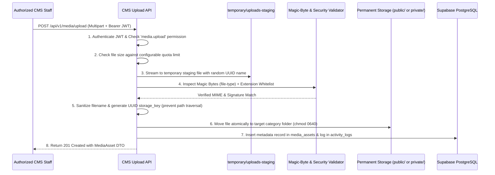

# STORAGE ARCHITECTURE: BABAWATOTO MEDIA & DOCUMENT SYSTEM

## 1. Storage Design Principles
1. **Primary Storage Provider**: Local cPanel filesystem outside `public_html` (`/home/babawatotoor/bao-cms-storage`), preventing direct unvalidated web access or script execution.
2. **Zero Binary Blobs in PostgreSQL**: Uploaded files are never stored as `BYTEA` inside Supabase PostgreSQL; only structured metadata and relative `storage_key` references are persisted in `public.media_assets`.
3. **Strict Separation of Public and Private Files**:
   - **Public Assets**: Approved website images, partner logos, and published PDF resources are stored under `public/` subtrees and served via controlled, cache-optimized streaming endpoints.
   - **Private Assets**: Signed safeguarding consent forms, internal verification documents, and unpublished drafts are stored under `private/` and can only be downloaded through an authenticated, permission-checked CMS API endpoint (`/api/v1/media/:id/download-private`).
4. **Pluggable Storage Abstraction**: All filesystem operations go through a TypeScript `StorageProvider` interface so that Cloudflare R2 or AWS S3 can be enabled via environment variables later without modifying CMS business logic.

---

## 2. Physical Directory Hierarchy on cPanel

```text
/home/babawatotoor/bao-cms-storage/
├── public/
│   ├── images/
│   │   ├── organization/
│   │   ├── programmes/
│   │   ├── projects/
│   │   ├── staff/
│   │   ├── stories/
│   │   └── events/
│   ├── documents/
│   │   ├── reports/
│   │   ├── publications/
│   │   ├── policies/
│   │   └── resources/
│   └── videos/
├── private/
│   ├── safeguarding-consents/
│   ├── impact-verification/
│   └── volunteer-cvs/
└── temporary/
    └── uploads-staging/
```

### Filesystem Permissions
- Directories: `0750` (`rwxr-x---`, owned by `babawatotoor:babawatotoor`)
- Stored Files: `0640` (`rw-r-----`, non-executable)
- No `.php`, `.sh`, `.py`, `.pl`, `.cgi`, `.js`, `.exe`, or `.htaccess` files can ever be written to `bao-cms-storage`.

---

## 3. Modular Storage Interface (`StorageProvider`)

```typescript
export interface PutObjectInput {
  storageKey: string;
  visibility: 'public' | 'private';
  buffer: Buffer;
  mimeType: string;
}

export interface StorageUsageStats {
  totalBytesUsed: number;
  publicBytesUsed: number;
  privateBytesUsed: number;
  fileCount: number;
  configuredQuotaBytes: number;
}

export interface IStorageProvider {
  readonly providerName: 'cpanel_local' | 'cloudflare_r2';
  saveFile(input: PutObjectInput): Promise<{ storageKey: string; sizeBytes: number }>;
  replaceFile(existingStorageKey: string, input: PutObjectInput): Promise<{ sizeBytes: number }>;
  deleteFile(storageKey: string, visibility: 'public' | 'private'): Promise<void>;
  getReadStream(storageKey: string, visibility: 'public' | 'private'): Promise<NodeJS.ReadableStream>;
  fileExists(storageKey: string, visibility: 'public' | 'private'): Promise<boolean>;
  getUsageStats(): Promise<StorageUsageStats>;
  cleanupTemporaryFiles(maxAgeMinutes: number): Promise<number>;
}
```

---

## 4. Upload Security & Validation Pipeline

Every file uploaded to the CMS passes through an 8-step validation pipeline before being moved from `temporary/uploads-staging/` to permanent storage:



### Allowed File Types & Default Size Limits (Configurable in Website Settings)

| Media Type | Allowed Extensions | Verified MIME Types | Default Max Size |
| :--- | :--- | :--- | :--- |
| **Images** | `.jpg`, `.jpeg`, `.png`, `.webp`, `.avif` | `image/jpeg`, `image/png`, `image/webp`, `image/avif` | `10 MB` |
| **Documents** | `.pdf`, `.docx`, `.xlsx`, `.pptx` | `application/pdf`, OpenXML MIME types | `25 MB` |
| **Videos** | `.mp4`, `.webm` | `video/mp4`, `video/webm` | `100 MB` |

> [!WARNING]
> **SVG Restriction**: Raw `.svg` uploads are disallowed by default because SVGs can embed executable `<script>` payloads. Organization and partner logos should use high-resolution transparent `.png` or `.webp`.

---

## 5. File Replacement, Deletion & Cleanup Lifecycle
1. **Atomic File Replacement**: When a staff member replaces a file in the Media Library, the new file is validated first, written to disk, and the old file is unlinked only after the new write succeeds. The `media_assets.id` remains unchanged so no broken links occur on pages or resources.
2. **Reference-Checked Deletion**: Attempting to delete a media asset queries `content_media`, `pages`, `programmes`, `projects`, `articles`, `stories`, `partners`, and `resources`. If referenced, deletion is blocked with a clear list of pages/records using the file.
3. **Temporary File Reaper**: A scheduled background job runs every 60 minutes (and on server startup) to purge any abandoned files in `temporary/uploads-staging/` older than 30 minutes.
