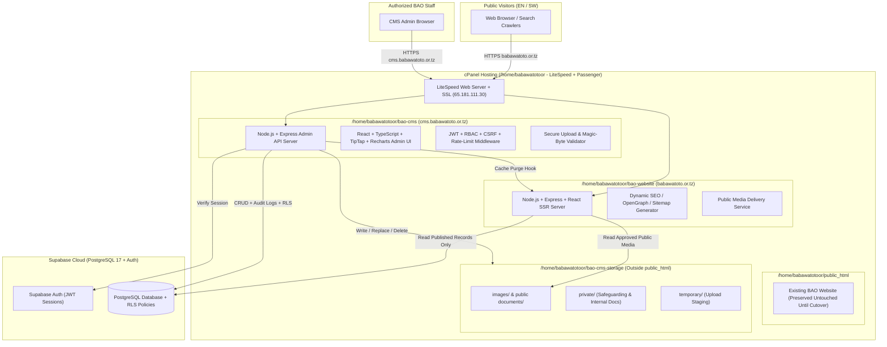

# SYSTEM ARCHITECTURE: BABAWATOTO WEBSITE & CUSTOM CMS

## 1. Hosting Constraints Analysis & Architectural Decision

### 1.1 cPanel Shared Hosting Constraints
The production environment at `babawatoto.or.tz` operates on a **LiteSpeed cPanel Shared Hosting** account with the following hard limits:
- **Physical Memory (RAM)**: `2 GB` total across the entire cPanel account.
- **Entry Processes**: `30` concurrent processes maximum.
- **Process Manager**: cPanel Node.js Selector (powered by Phusion Passenger / LiteSpeed `lsnode.js`).

### 1.2 Why Heavy Multi-Process Next.js Server Deployments Fail on 2 GB cPanel
Running two separate Next.js SSR Node.js servers (`bao-website` + `bao-cms`) on a 2 GB RAM cPanel account frequently triggers **503 Service Unavailable** and **Out-Of-Memory (OOM) SIGKILL** errors because:
1. Next.js standalone production servers spawn multiple worker threads/child processes and consume `350 MB – 750 MB` of resident memory per instance under load.
2. Building Next.js directly on cPanel exceeds the 2 GB virtual memory ceiling during webpack/turbopack compilation.
3. Passenger requires a standard Node.js HTTP entry file (`server.js`) and manages port binding automatically; Next.js dynamic image optimization (`sharp`) spikes CPU and entry processes.

### 1.3 Selected Architecture: Lightweight Node.js + TypeScript + React SSR/SPA Hybrid
To guarantee **100% stability within the 2 GB RAM and 30 Entry Process limits** while fulfilling every requirement in the specification (React, TypeScript, Tailwind CSS, dynamic SEO metadata, fast LCP, and logical separation of Website and CMS):

We will structure the repository as a **TypeScript Monorepo** that deploys cleanly to the two required cPanel directories (`/home/babawatotoor/bao-website` and `/home/babawatotoor/bao-cms`):

1. **`bao-website` (Public Website Application — `babawatoto.or.tz`)**:
   - **Runtime**: Lightweight Node.js + Express/Fastify TypeScript server (`server.js` entry point compatible with cPanel Passenger) paired with **React 19 + TypeScript + Tailwind CSS + Vite SSR**.
   - **Why Vite SSR + Express instead of heavy Next.js**:
     - Memory footprint is **`~65 MB – 110 MB` RAM** (vs `500 MB+` for Next.js).
     - Full **Server-Side Rendering (SSR)** for dynamic `<head>` SEO metadata (Page Titles, Meta Descriptions, Canonical URLs, Open Graph tags, JSON-LD structured data, dynamic `sitemap.xml` and `robots.txt`).
     - Built-in lightweight in-memory LRU cache (`ttl: 60s` with instant webhook/API purge from the CMS) so repeat visitors are served in `< 15ms` without hitting Supabase on every request.
     - Streams approved public media files directly from `/home/babawatotoor/bao-cms-storage/public/` with immutable HTTP caching headers.

2. **`bao-cms` (Administrative CMS Application — `cms.babawatoto.or.tz`)**:
   - **Runtime**: Dedicated Node.js + Express TypeScript API & App server (`/home/babawatotoor/bao-cms/server.js`) serving the **React + TypeScript + Tailwind CSS Administrative SPA** and the **Secure Admin & Media REST API**.
   - **Why this works seamlessly on cPanel**:
     - The React CMS frontend compiles to static, fingerprinted assets served by the Node/LiteSpeed layer, consuming zero SSR memory overhead for admin views.
     - The Node.js backend handles all privileged operations: Supabase Service-Role verification, RBAC enforcement, multipart file upload streaming, magic-byte file signature inspection, filesystem writes to `/home/babawatotoor/bao-cms-storage/`, private document streaming, and audit logging.
     - Memory footprint is **`~70 MB – 120 MB` RAM**.
   - **Single-Process Fallback Option**: If the hosting provider restricts the number of active Node.js applications to 1, `bao-website` and `bao-cms` can also be mounted via virtual-host (`Host: cms.babawatoto.or.tz` vs `Host: babawatoto.or.tz`) inside a single Node.js Passenger process while still keeping their codebases and build directories strictly separated.

---

## 2. High-Level System Architecture Diagram



---

## 3. Repository & Project Folder Structure

We will use an npm workspaces monorepo so shared TypeScript interfaces, Zod schemas, design tokens, and block renderers are 100% consistent between the Public Website and the CMS, while producing two independent deployment bundles (`bao-website` and `bao-cms`):

```text
baoweb/
├── package.json                       # Monorepo workspace root & scripts
├── tsconfig.base.json                 # Strict shared TypeScript configuration
├── .env.example                       # Documented environment variable template
├── PROJECT_REQUIREMENTS.md
├── SYSTEM_ARCHITECTURE.md
├── DATABASE_SCHEMA.md
├── CMS_MODULES.md
├── USER_ROLES_AND_PERMISSIONS.md
├── STORAGE_ARCHITECTURE.md
├── DEPLOYMENT_GUIDE.md
├── SECURITY_REQUIREMENTS.md
│
├── packages/
│   └── shared/                        # Shared TypeScript types, Zod schemas & constants
│       ├── package.json
│       └── src/
│           ├── types/                 # Database entity types, Page Builder block types, RBAC types
│           ├── schemas/               # Shared Zod validation schemas (Forms, Blocks, API payloads)
│           ├── constants/             # Roles, Permissions, Workflow statuses, Supported locales
│           └── i18n/                  # Static UI labels (navigation labels, empty state copy in EN/SW)
│
├── apps/
│   ├── bao-website/                   # Public Website Application (deploys to /home/babawatotoor/bao-website)
│   │   ├── package.json
│   │   ├── server.ts                  # Express + SSR entry point (compiles to dist/server.js for cPanel)
│   │   ├── vite.config.ts
│   │   └── src/
│   │       ├── entry-server.tsx       # React SSR renderer with dynamic SEO & JSON-LD
│   │       ├── entry-client.tsx       # Client hydration entry
│   │       ├── routes/                # All 10 required public route templates + policy pages
│   │       ├── components/
│   │       │   ├── layout/            # Header, Navigation, MobileNav, Footer, Breadcrumbs, LanguageSwitcher
│   │       │   ├── blocks/            # 16 Controlled Page-Builder Block Renderers
│   │       │   ├── cards/             # ProgrammeCard, ProjectCard, NewsCard, StoryCard, ResourceCard
│   │       │   ├── feedback/          # Polished EmptyState, LoadingState, ErrorState
│   │       │   └── ui/                # Accessible buttons, inputs, pagination, search bar
│   │       ├── services/              # Read-only data fetching service (published content only)
│   │       └── styles/                # Tailwind CSS with BAO Design System tokens
│   │
│   └── bao-cms/                       # Administrative CMS Application (deploys to /home/babawatotoor/bao-cms)
│       ├── package.json
│       ├── server.ts                  # Express Admin API + Static SPA host (compiles to dist/server.js)
│       ├── vite.config.ts
│       └── src/
│           ├── api/                   # Backend Express controllers & middleware
│           │   ├── middleware/        # Auth verification, RBAC check, rate limiter, error handler
│           │   ├── routes/            # REST endpoints for all 16 CMS modules
│           │   ├── storage/           # Modular StorageProvider (LocalCpanelStorage + R2 adapter interface)
│           │   └── services/          # Audit logger, workflow state machine, media processor
│           └── client/                # React + TypeScript Admin Dashboard SPA
│               ├── pages/             # All 16 CMS module screens
│               ├── components/
│               │   ├── layout/        # AdminSidebar, Topbar, RoleBadge, LanguageTabs
│               │   ├── page-builder/  # Visual Block Editor for the 16 controlled blocks
│               │   ├── editor/        # Sanitized TipTap Rich-Text Editor
│               │   ├── media/         # MediaPickerModal, UploadDropzone, MediaGrid
│               │   └── charts/        # Recharts impact & dashboard visualizations
│               └── hooks/             # Auth context, permission guard hooks, autosave hooks
│
├── supabase/
│   └── migrations/                    # Versioned PostgreSQL SQL migrations (tables, indexes, RLS, triggers)
│       ├── 0001_initial_schema.sql
│       ├── 0002_rls_policies.sql
│       └── 0003_seed_roles_permissions_navigation.sql
│
└── tests/
    ├── unit/                          # Vitest unit & schema validation tests
    ├── api/                           # Vitest API authorization, RBAC & upload validation tests
    └── e2e/                           # Playwright end-to-end tests for Public Website & CMS
```

---

## 4. Technology Stack Specification

| Layer | Technology | Rationale |
| :--- | :--- | :--- |
| **Frontend UI** | React 19 + TypeScript | Strict type safety, component reusability across Website & CMS |
| **Styling** | Tailwind CSS v4 + Custom Design Tokens | Enforces BAO color palette (`#303432`, `#B77936`, `#F4F5F4`) and responsive typography |
| **Icons** | `lucide-react` | Clean, consistent iconography without decorative bloat |
| **Backend Server** | Node.js + Express + TypeScript | First-class compatibility with cPanel Phusion Passenger / `lsnode.js` and minimal RAM footprint |
| **Database & Auth** | Supabase PostgreSQL + Supabase Auth | Managed PostgreSQL 17 with Row Level Security (RLS) and secure JWT authentication |
| **Rich Text Editor** | TipTap (`@tiptap/react` + StarterKit) | Structured, sanitized rich-text editing without arbitrary script injection |
| **Forms & Validation** | React Hook Form + Zod | Shared client and server validation schemas |
| **Data Visualization** | Recharts | Accessible, responsive impact charts and CMS statistics |
| **Security & Uploads** | `helmet`, `express-rate-limit`, `multer`, `file-type`, `isomorphic-dompurify` | Magic-byte file inspection, XSS sanitization, rate limiting, and secure HTTP headers |
| **Testing** | Vitest + Supertest + Playwright | Comprehensive unit, API RBAC, and browser E2E verification |
