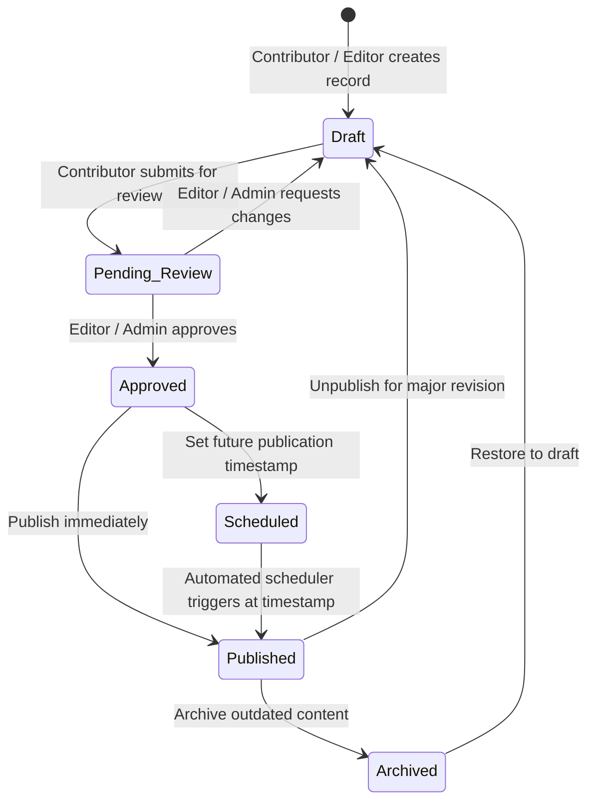

# USER ROLES AND PERMISSIONS: BABAWATOTO CMS

## 1. Role-Based Access Control (RBAC) Architecture
Authorization is enforced through **defense-in-depth**:
1. **API Middleware Layer**: Every CMS API route validates the user's Supabase JWT and checks their effective permissions via `user_roles -> role_permissions -> permissions` before executing business logic.
2. **Database Row Level Security (RLS)**: PostgreSQL RLS policies on all 31 tables enforce read/write rules directly inside Supabase using security-definer helper functions (`public.has_permission(permission_code TEXT)` and `public.has_role(role_slug TEXT)`).
3. **UI Presentation Layer**: The React CMS hides unauthorized navigation items and action buttons for usability, while never relying on frontend hiding for security.

---

## 2. Defined Roles

| Role Name | Slug | Summary of Authority |
| :--- | :--- | :--- |
| **Super Administrator** | `super_admin` | Complete unrestricted control over users, roles, system settings, storage configuration, safeguarding approvals, and all content modules. |
| **Website Administrator** | `website_admin` | Full operational control over all website content, navigation menus, website settings, media library, and publishing workflows (cannot modify Super Admin accounts or core role definitions). |
| **Editor** | `editor` | Creates, edits, reviews, approves, schedules, and publishes content across all content modules (Pages, Programmes, Projects, News, Events, Stories, Partners, Resources, Impact). |
| **Contributor** | `contributor` | Creates and edits drafts in assigned content modules and uploads supporting media, but **cannot publish or approve**—must submit items as `Pending Review`. |
| **Media Manager** | `media_manager` | Full control over the Media Library (upload, categorize, edit metadata/alt-text, replace files, delete unused assets, manage storage folders). |
| **Viewer** | `viewer` | Read-only access to the CMS dashboard, content previews, and analytics/impact summaries. Cannot create, modify, upload, or delete any record. |

---

## 3. Granular Permission Matrix

| Permission Code | Super Admin | Website Admin | Editor | Contributor | Media Manager | Viewer |
| :--- | :---: | :---: | :---: | :---: | :---: | :---: |
| `dashboard.view` | Yes | Yes | Yes | Yes | Yes | Yes |
| `content.view_drafts` | Yes | Yes | Yes | Yes | Yes | Yes |
| `pages.create_edit` | Yes | Yes | Yes | Yes | No | No |
| `pages.publish` | Yes | Yes | Yes | No | No | No |
| `pages.delete` | Yes | Yes | No | No | No | No |
| `programmes.create_edit` | Yes | Yes | Yes | Yes | No | No |
| `programmes.publish` | Yes | Yes | Yes | No | No | No |
| `projects.create_edit` | Yes | Yes | Yes | Yes | No | No |
| `projects.publish` | Yes | Yes | Yes | No | No | No |
| `projects.delete` | Yes | Yes | No | No | No | No |
| `articles.create_edit` | Yes | Yes | Yes | Yes | No | No |
| `articles.publish` | Yes | Yes | Yes | No | No | No |
| `articles.delete` | Yes | Yes | Yes | No | No | No |
| `stories.create_edit` | Yes | Yes | Yes | Yes | No | No |
| `stories.safeguarding_approve` | Yes | Yes | Yes | No | No | No |
| `stories.publish` | Yes | Yes | Yes | No | No | No |
| `partners.manage` | Yes | Yes | Yes | No | No | No |
| `resources.create_edit` | Yes | Yes | Yes | Yes | Yes | No |
| `resources.publish` | Yes | Yes | Yes | No | No | No |
| `impact.create_edit` | Yes | Yes | Yes | Yes | No | No |
| `impact.publish` | Yes | Yes | Yes | No | No | No |
| `media.upload` | Yes | Yes | Yes | Yes | Yes | No |
| `media.edit_metadata` | Yes | Yes | Yes | Yes | Yes | No |
| `media.replace` | Yes | Yes | Yes | No | Yes | No |
| `media.delete` | Yes | Yes | No | No | Yes | No |
| `media.view_private` | Yes | Yes | Yes | No | Yes | No |
| `menus.manage` | Yes | Yes | No | No | No | No |
| `settings.manage` | Yes | Yes | No | No | No | No |
| `messages.manage` | Yes | Yes | Yes | No | No | No |
| `users.manage` | Yes | No | No | No | No | No |
| `roles.manage` | Yes | No | No | No | No | No |
| `audit_logs.view` | Yes | Yes | No | No | No | No |

---

## 4. Content Publishing Workflow Rules

1. **Public Visibility Rule**: The public website (`babawatoto.or.tz`) only queries records where `status = 'published'` AND the requested language translation has `translation_status = 'published'`.
2. **Independent Translation Status**: An English page or article can be `published` while its Kiswahili translation is still in `draft` or `pending_review`. If a visitor switches to Kiswahili on a page whose Kiswahili translation is not yet published, the website displays a clear bilingual notice and falls back gracefully without exposing draft content.
3. **Preview Mode**: Authenticated CMS users with `content.view_drafts` can preview any draft/pending page via a signed short-lived preview token (`/preview?token=...`).
